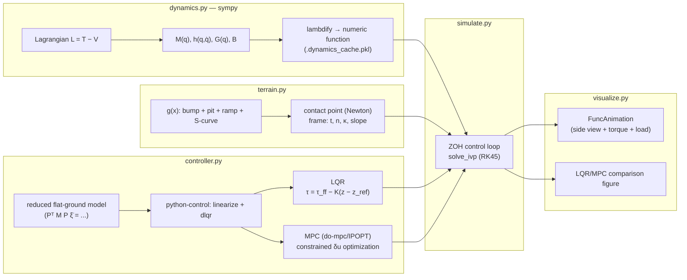

# Wheeled Biped Robot — Sagittal-Plane Simulation

[](LICENSE)
[](requirements.txt)

> Turkish version: [README.md](README.md)

A fully **analytically-derived** Python simulation of a single-wheel, two-link-leg
("wheeled-biped") robot balancing and driving over aggressive terrain (bumps, pits, ramps,
S-curves). The equations of motion are derived symbolically from the Lagrangian with sympy,
the wheel–ground contact is enforced as a holonomic constraint through a Lagrange-multiplier
KKT system, and control is implemented and compared between LQR and constrained MPC
(do-mpc/IPOPT).

## Preview

| Flat-ground comparison | Obstacle-course comparison | Speed-step comparison |
|---|---|---|
|  |  |  |

Animations (`results/*.mp4`): `course_lqr.mp4` (LQR driving the obstacle course) and
`flat_lqr.mp4` (balancing + speed command + a kick, on flat ground) — included in the
`results/` folder of the repo.

## Architecture / Data Flow



Each control period (`dt`): the ground point nearest the wheel center is found
(`terrain.contact`) → measurement (`controller.measure`) → the controller (LQR or MPC) produces
τ → τ is held (ZOH) while `solve_ivp` integrates the constrained dynamics over `[t, t+dt]`
(`dynamics.constrained_accel`, KKT).

## Model

Generalized, floating-base coordinates: `q = [x, y, θ, q1, q2, φ]` (hip position, body pitch,
hip angle, knee angle, wheel spin). Since the left and right legs coincide in the sagittal
plane, they are modeled as **one equivalent leg** (thigh + shank, combined mass/inertia).

Equations of motion (Euler–Lagrange, derived symbolically in `dynamics.derive_symbolic`):

```
M(q) q̈ + h(q, q̇) + G(q) = B τ + Jcᵀ λ         τ = [τ_hip, τ_knee, τ_wheel]
```

The wheel–ground contact is a bilateral (no-slip rolling) constraint:

```
Jc q̈ = −J̇c q̇  (+ Baumgarte stabilization)         λ = [N, F_t]  (normal, tangential force)
```

**Control architecture:** on flat ground with the rolling constraint, the system reduces to 4
independent coordinates (`x_c, θ, q1, q2`); wrapped as `control.nlsys` and linearized at the
trim point with `control.linearize` (7 states, 3 inputs). Control law in error coordinates:

```
τ = τ_ff(α) − K (z − z_ref(α, v_ref))
```

`α` is the local ground slope under the wheel; `(θ_ref(α), τ_ff(α))` are pre-tabulated via
`static_trim`. `K` is either a discrete LQR gain (`ct.dlqr`) or a constrained MPC (do-mpc,
IPOPT — subject to motor-torque, joint-deviation and pitch-error constraints; falls back to the
LQR gain if the solve fails).

## Code structure

| File | Contents |
|---|---|
| `dynamics.py` | sympy Lagrangian → `M(q), h(q,q̇), G(q), B`; lambdify; wheel–ground KKT solve; static trim |
| `terrain.py` | Smooth (C∞) ground profile (bump, pit, ramp, S-curve) + contact point/frame/curvature |
| `controller.py` | Reduced flat-ground model → python-control linearization → LQR; constrained MPC via do-mpc |
| `simulate.py` | `solve_ivp` (RK45) + ZOH control loop, scenarios (`flat`/`course`/`step`), metrics |
| `visualize.py` | Dark-themed `FuncAnimation` (side view + torque + load plot) and LQR/MPC comparison figure |
| `tests/test_model.py` | Model validation (see Tests below) |
| `results/` | Sample outputs (`.npz`, `.mp4`, comparison `.png`, `metrics_step.txt`) |

## Setup / usage

```bash
pip install -r requirements.txt
python tests/test_model.py                                    # model validation
python simulate.py --scenario flat   --controller both --save results/flat      # balance on flat ground
python simulate.py --scenario course --controller both --save results/course    # obstacle course
python simulate.py --scenario step   --controller both --pitch_limit 0.01 --save results/step
python visualize.py results/course_lqr.npz --terrain course                     # animation window
python visualize.py results/course_lqr.npz --terrain course --save anim.mp4     # mp4 (ffmpeg) / .gif
python visualize.py results/step_lqr.npz results/step_mpc.npz --terrain flat --compare cmp.png
```

The first run takes ~10 s for the sympy derivation; the result is cached as
`.dynamics_cache.pkl`. `.mp4` export needs `ffmpeg` on the system; `.gif` needs `pillow`
(already in `requirements.txt`).

## Tests (`tests/test_model.py`)

Six independent checks validate both internal consistency and agreement with an external
reference implementation:

| Test | What it checks |
|---|---|
| `test_against_sympy_mechanics` | `M`, `h+G` match an independent derivation via `sympy.physics.mechanics.LagrangesMethod` |
| `test_energy_conservation` | Frictionless/torque-free/unconstrained free motion conserves total energy (`ptp(E) < 1e-7` J) |
| `test_constraint_consistency` | Constraint Jacobian, consistent velocity and KKT acceleration agree along the whole course |
| `test_contact_acceleration_matches_finite_difference` | Contact-acceleration formulas (curvature terms included) verified by time integration + finite differences on a bump (κ ≠ 0) |
| `test_reduced_model_matches_kkt` | The reduced flat-ground model used by the controller (PᵀMP) matches the full KKT solution |
| `test_terrain_derivatives` | Ground derivatives (g', g'', g''') are consistent with finite differences |

Run with: `python tests/test_model.py` (or `pytest tests/`).

## Results (100 Hz control)

| Scenario | Controller | RMS speed error | max pitch error | N range [N] | control time |
|---|---|---|---|---|---|
| flat ground (0.15 rad initial error + 0.8 m/s + kick) | LQR / MPC | 0.183 / 0.183 m/s | 8.6° (initial) | 71–150 | 0.09 / 10.8 ms |
| obstacle course, 1.5 m/s | LQR / MPC | 0.026 / 0.026 m/s | 1.39° / 1.39° | 73.9–92.9 | 0.09 / 11.9 ms |
| sudden speed step 0→1.5 m/s, MPC pitch limit 0.57° | LQR / MPC | 0.418 / 0.418 m/s | 0.80° / **0.56°** | 37.4–96.9 | 0.07 / 12.9 ms |

(`results/metrics_step.txt` holds the full metric dump for the step scenario — including
`rms_tau_wheel`, `max_abs_tau`, `max_friction_ratio`.)

Since constraints never become active on flat ground or the course, MPC ≡ LQR there (at
~100× the compute cost). MPC's real advantage shows up once a constraint is active (it
respects the pitch limit in the step scenario, LQR overshoots it). Because the MPC uses a
linear model, it has no advantage over LQR for large (≳30°) deviations.

## Limitations

* Contact is bilateral; N<0 (wheel lift-off) is detected and flagged but the flight phase is
  not modeled.
* The friction cone is not enforced; the required |F_t|/N ratio is reported instead (≤0.11 on
  the course, ≈1.0 in the step test).
* Full-state measurement, no noise/latency/actuator dynamics. The linear MPC model is based on
  the flat-ground linearization.
* Parameters (mass, lengths, torque limits) live in `dynamics.Params`, chosen for a plausible
  small robot.

## References

| Topic | Source |
|---|---|
| Lagrangian mechanics, Euler–Lagrange | `sympy.physics.mechanics` documentation |
| Floating-base constrained dynamics, KKT contact | Featherstone, *Rigid Body Dynamics Algorithms*, 2008 |
| Baumgarte stabilization | Baumgarte, J. (1972). *Stabilization of constraints and integrals of motion in dynamical systems* |
| Linear systems tooling, `linearize`/`dlqr` | [python-control](https://python-control.readthedocs.io/) documentation |
| Constrained MPC | [do-mpc](https://www.do-mpc.com/) documentation; Rawlings, Mayne & Diehl, *Model Predictive Control: Theory, Computation, and Design* |
| Symbolic derivation / lambdify | [SymPy](https://docs.sympy.org/) documentation |

## Attribution

The subject of this project (wheeled-biped robot control) was inspired by content shared on
Instagram by [@veer.alak.sim](https://www.instagram.com/veer.alak.sim/), titled
**"Wheeled Biped Robot Control."** The modeling, derivation and code in this repository are
written entirely independently; no code or data is shared with the original post.

## License

[MIT](LICENSE) © 2026 Musa Buğra Demir. Third-party libraries used (numpy, scipy, sympy,
matplotlib, python-control, pillow: BSD/MIT-style; **CasADi and do-mpc: LGPLv3+**) remain
under their own licenses — this project uses them as dependencies and does not vendor their
source.
