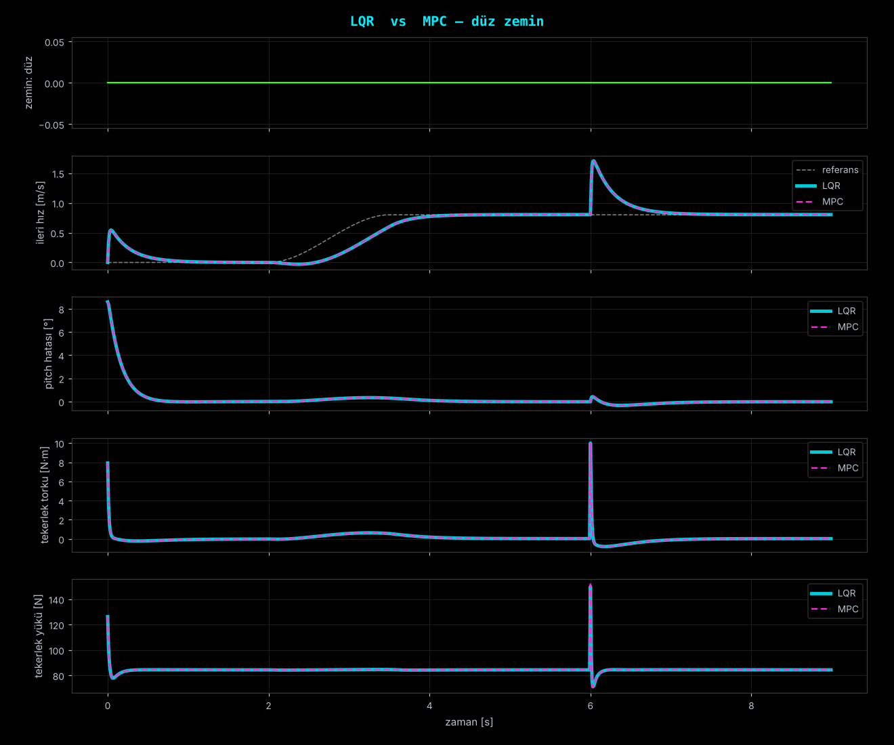
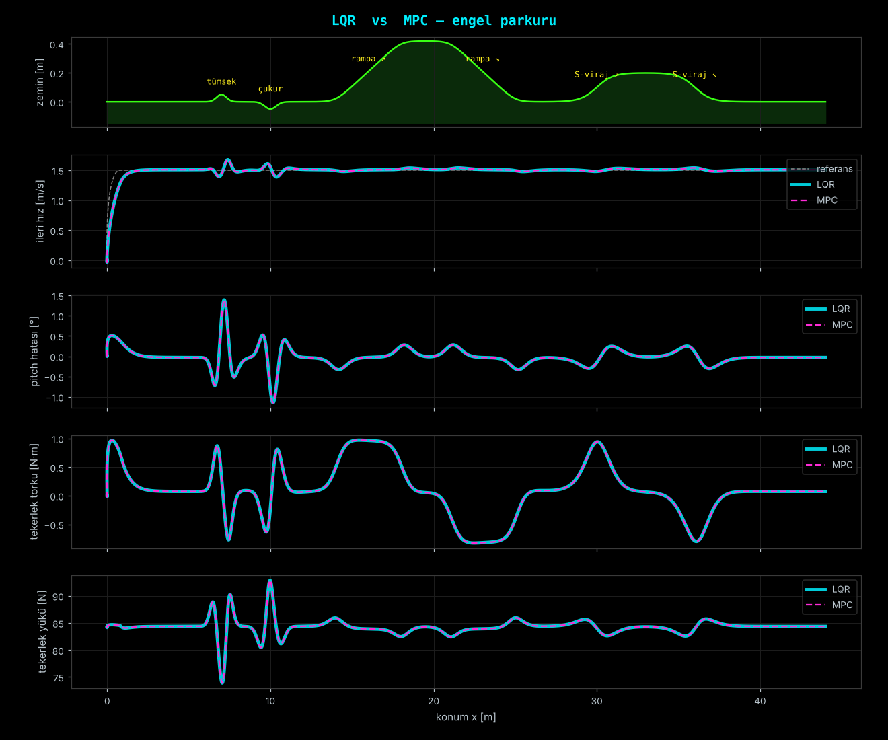
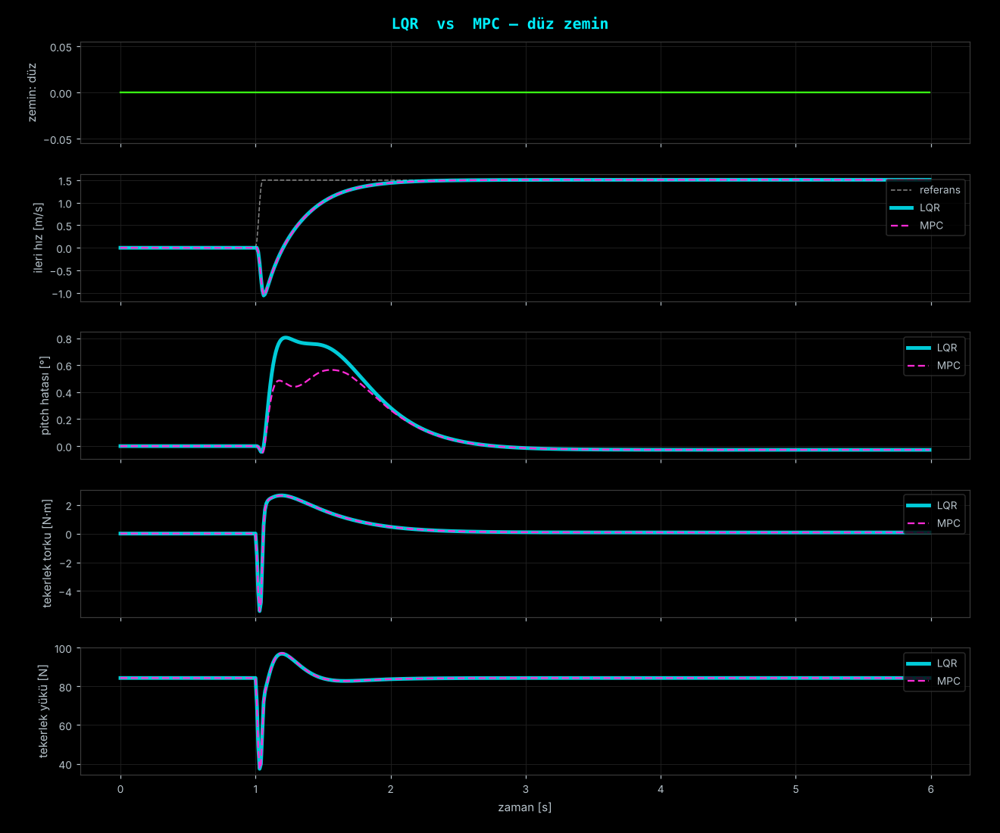
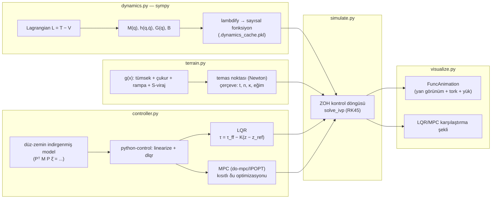

# Tekerlekli İki-Linkli-Bacaklı Robot — Sagittal Düzlem Simülasyonu

[](LICENSE)
[](requirements.txt)

> English version: [README.en.md](README.en.md)

Tek tekerlekli, iki eklemli bacağa (kalça + diz) sahip bir "wheeled-biped" robotun agresif bir
arazide (tümsek, çukur, rampa, S-viraj) dengesini koruyarak ilerlemesini simüle eden,
baştan sona **analitik türetilmiş** bir Python projesi. Dinamik denklemler sympy ile
Lagrangian'dan çıkarılır, tekerlek–zemin teması Lagrange çarpanlı bir KKT sistemiyle
kısıtlanır, kontrol LQR ve kısıtlı MPC (do-mpc/IPOPT) ile karşılaştırmalı olarak uygulanır.

## Önizleme

| Düz zemin karşılaştırma | Engel parkuru karşılaştırma | Ani hız adımı karşılaştırma |
|---|---|---|
|  |  |  |

Animasyonlar (`results/*.mp4`): `course_lqr.mp4` (engel parkurunda LQR ile ilerleyiş) ve
`flat_lqr.mp4` (düz zeminde dengeleme + hız komutu + itme) — depoda `results/` klasöründe bulunur.

## Mimari / Veri Akışı



Her kontrol periyodunda (`dt`): tekerlek merkezine en yakın zemin noktası bulunur (`terrain.contact`)
→ ölçüm (`controller.measure`) → kontrolör (LQR ya da MPC) τ üretir → τ sabit tutularak
(`[t, t+dt]`) `solve_ivp` ile kısıtlı dinamik (`dynamics.constrained_accel`, KKT) integre edilir.

## Model

Genelleştirilmiş koordinatlar, floating-base: `q = [x, y, θ, q1, q2, φ]`
(kalça konumu, gövde pitch'i, kalça açısı, diz açısı, tekerlek dönüşü). Sağ/sol bacak sagittal
düzlemde çakıştığı için **tek eşdeğer bacak** (uyluk + baldır, kütle/atalet toplamı) olarak
modellenmiştir.

Hareket denklemi (Euler–Lagrange'dan sympy ile türetilir, `dynamics.derive_symbolic`):

```
M(q) q̈ + h(q, q̇) + G(q) = B τ + Jcᵀ λ         τ = [τ_kalça, τ_diz, τ_tekerlek]
```

Tekerlek–zemin teması bilateral kısıt olarak eklenir (kayma yok, yuvarlanma):

```
Jc q̈ = −J̇c q̇  (+ Baumgarte sönümleme)         λ = [N, F_t]  (normal, teğet kuvvet)
```

**Kontrol mimarisi:** düz zemin + yuvarlanma kısıtı altında sistem 4 bağımsız koordinata
(`x_c, θ, q1, q2`) indirgenir; `control.nlsys` ile sarılıp trim noktasında `control.linearize`
ile lineerleştirilir (7 durum, 3 giriş). Kontrol yasası hata koordinatında:

```
τ = τ_ff(α) − K (z − z_ref(α, v_ref))
```

`α`: tekerlek altındaki yerel zemin eğimi; `(θ_ref(α), τ_ff(α))` önceden `static_trim` ile
tablolanır. `K`: ayrık LQR (`ct.dlqr`) veya kısıtlı MPC (do-mpc, IPOPT — motor torku, eklem
sapması ve pitch hatası kısıtlarıyla; çözüm başarısız olursa LQR'a düşer).

## Kod yapısı

| Dosya | İçerik |
|---|---|
| `dynamics.py` | sympy ile Lagrangian → `M(q), h(q,q̇), G(q), B`; lambdify; tekerlek–zemin KKT çözümü; statik trim |
| `terrain.py` | Smooth (C∞) zemin profili (tümsek, çukur, rampa, S-viraj) + temas noktası/çerçevesi/eğrilik |
| `controller.py` | İndirgenmiş düz-zemin modeli → python-control lineerizasyonu → LQR; do-mpc ile kısıtlı MPC |
| `simulate.py` | `solve_ivp` (RK45) + ZOH kontrol döngüsü, senaryolar (`flat`/`course`/`step`), metrikler |
| `visualize.py` | Koyu temalı `FuncAnimation` (yan görünüm + tork + yük grafiği) ve LQR/MPC karşılaştırma şekli |
| `tests/test_model.py` | Model doğrulama (bkz. aşağıdaki Testler bölümü) |
| `results/` | Örnek çıktılar (`.npz`, `.mp4`, karşılaştırma `.png`, `metrics_step.txt`) |

## Kurulum / çalıştırma

```bash
pip install -r requirements.txt
python tests/test_model.py                                    # model doğrulama
python simulate.py --scenario flat   --controller both --save results/flat      # düz zeminde denge
python simulate.py --scenario course --controller both --save results/course    # engel parkuru
python simulate.py --scenario step   --controller both --pitch_limit 0.01 --save results/step
python visualize.py results/course_lqr.npz --terrain course                     # animasyon penceresi
python visualize.py results/course_lqr.npz --terrain course --save anim.mp4     # mp4 (ffmpeg) / .gif
python visualize.py results/step_lqr.npz results/step_mpc.npz --terrain flat --compare cmp.png
```

İlk çalıştırmada sympy türetmesi ~10 s sürer; sonuç `.dynamics_cache.pkl` olarak önbelleğe alınır.
`.mp4` kaydı için sistemde `ffmpeg`, `.gif` için `pillow` gerekir (zaten `requirements.txt`'te).

## Testler (`tests/test_model.py`)

Altı bağımsız doğrulama testi, modelin kendi iç tutarlılığını ve harici bir referansla
örtüşmesini kontrol eder:

| Test | Ne doğrular |
|---|---|
| `test_against_sympy_mechanics` | `M`, `h+G`'nin `sympy.physics.mechanics.LagrangesMethod` ile bağımsız türetimle örtüştüğü |
| `test_energy_conservation` | Sürtünmesiz/torksuz/kısıtsız serbest hareket → toplam enerji korunumu (`ptp(E) < 1e-7` J) |
| `test_constraint_consistency` | Kısıt Jacobian'ı, tutarlı hız ve KKT ivmesinin parkur boyunca birbiriyle uyumu |
| `test_contact_acceleration_matches_finite_difference` | Tümsek üzerinde (κ ≠ 0) kısıt ivmesinin zaman integrasyonu + sonlu farkla doğrulanması |
| `test_reduced_model_matches_kkt` | Kontrolör için kullanılan indirgenmiş düz-zemin modelinin (PᵀMP) tam KKT çözümüyle örtüştüğü |
| `test_terrain_derivatives` | Zemin türevlerinin (g', g'', g''') sonlu farklarla tutarlılığı |

Çalıştırma: `python tests/test_model.py` (veya `pytest tests/`).

## Sonuçlar (100 Hz kontrol)

| Senaryo | Kontrolör | RMS hız hatası | maks pitch hatası | N aralığı [N] | kontrol süresi |
|---|---|---|---|---|---|
| düz zemin (0.15 rad hata + 0.8 m/s + itme) | LQR / MPC | 0.183 / 0.183 m/s | 8.6° (ilk hata) | 71–150 | 0.09 / 10.8 ms |
| engel parkuru, 1.5 m/s | LQR / MPC | 0.026 / 0.026 m/s | 1.39° / 1.39° | 73.9–92.9 | 0.09 / 11.9 ms |
| ani hız adımı 0→1.5 m/s, MPC pitch sınırı 0.57° | LQR / MPC | 0.418 / 0.418 m/s | 0.80° / **0.56°** | 37.4–96.9 | 0.07 / 12.9 ms |

(`results/metrics_step.txt` adım senaryosunun tam metrik çıktısıdır — `rms_tau_wheel`,
`max_abs_tau`, `max_friction_ratio` dahil tüm alanları içerir.)

Parkurda ve düz zeminde kısıtlar devreye girmediği için MPC ≡ LQR (≈100× hesap maliyeti). MPC'nin
gerçek farkı, kısıt aktif olduğunda görülür (adım senaryosunda pitch sınırına uyuyor, LQR aşıyor).
Sistem doğrusal modelle MPC yaptığından büyük (≳30°) sapmalarda LQR'a göre bir üstünlüğü yoktur.

## Sınırlamalar

* Temas bilateral; N<0 (tekerlek havalanması) tespit edilip uyarılır ama uçuş fazı modellenmemiştir.
* Sürtünme konisi zorlanmaz; gereken |F_t|/N oranı raporlanır (parkurda ≤0.11, adım testinde ≈1.0).
* Tam durum ölçümü, gürültü/gecikme/motor dinamiği yok. Doğrusal MPC düz-zemin lineerizasyonuna dayanır.
* Parametreler (kütle, uzunluk, tork sınırları) `dynamics.Params` içinde; makul bir küçük robota göre seçilmiştir.

## Kaynakça / References

| Konu | Kaynak |
|---|---|
| Lagrangian mekaniği, Euler–Lagrange | Lagrange's method — `sympy.physics.mechanics` dokümantasyonu |
| Floating-base kısıtlı dinamik, KKT ile temas | Featherstone, *Rigid Body Dynamics Algorithms*, 2008 |
| Baumgarte stabilizasyonu | Baumgarte, J. (1972). *Stabilization of constraints and integrals of motion in dynamical systems* |
| Doğrusal sistem araçları, `linearize`/`dlqr` | [python-control](https://python-control.readthedocs.io/) dokümantasyonu |
| Kısıtlı MPC | [do-mpc](https://www.do-mpc.com/) dokümantasyonu; Rawlings, Mayne & Diehl, *Model Predictive Control: Theory, Computation, and Design* |
| Sembolik türetme / lambdify | [SymPy](https://docs.sympy.org/) dokümantasyonu |

## Attribution

Bu projenin konusu (tekerlekli-iki-bacaklı robot kontrolü), Instagram'da
[@veer.alak.sim](https://www.instagram.com/veer.alak.sim/) hesabının paylaştığı
**"Wheeled Biped Robot Control"** içeriğinden esinlenmiştir. Modelleme, türetme ve kod
tamamen bu depoda bağımsız olarak yazılmıştır; orijinal paylaşımla hiçbir kod veya veri
paylaşımı yoktur.

## Lisans

[MIT](LICENSE) © 2026 Musa Buğra Demir. Kullanılan kütüphanelerin (numpy, scipy, sympy,
matplotlib, python-control, pillow: BSD/MIT benzeri; **CasADi ve do-mpc: LGPLv3+**) kendi
lisansları geçerlidir — bu proje onları bağımlılık olarak kullanır, kodlarını içermez.
